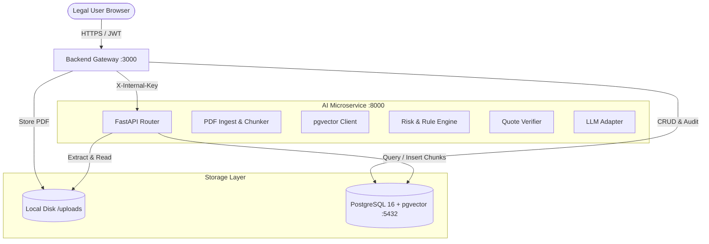
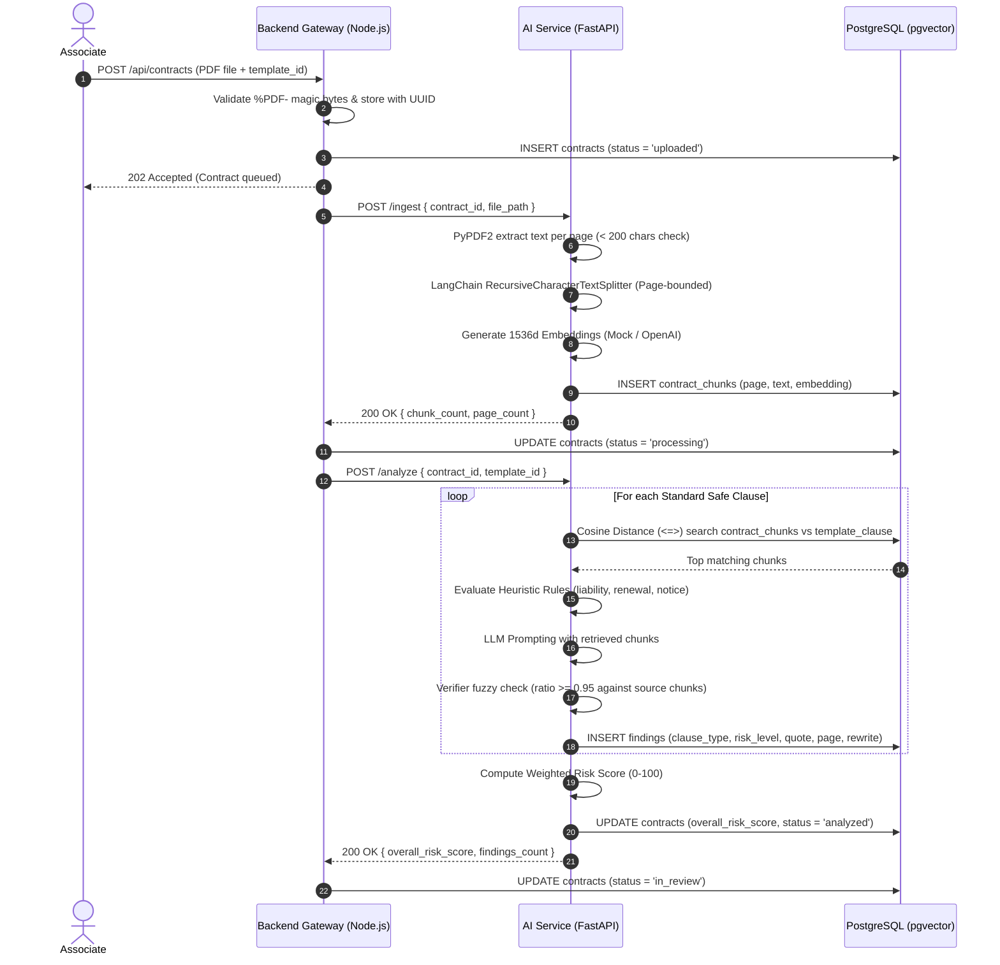
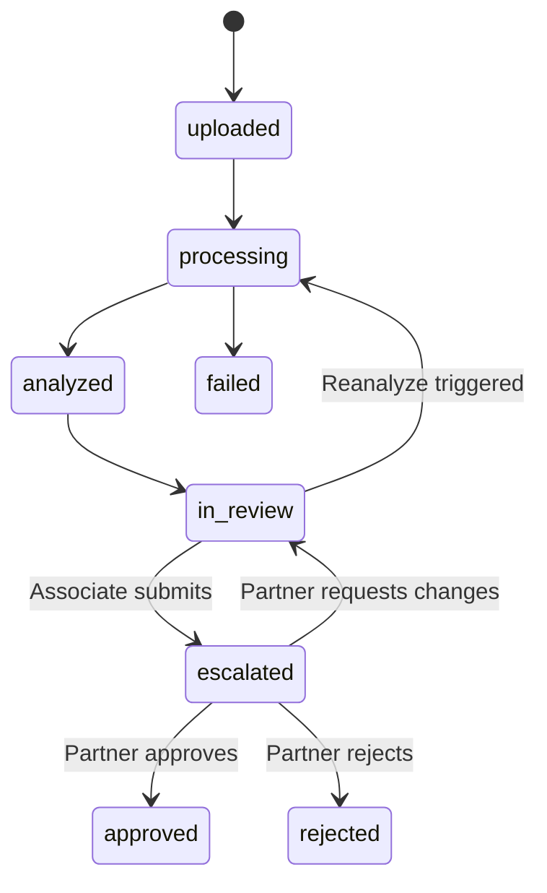

# Architecture Specification: Intelligent Legal Contract & Vendor Risk Analyzer

This document details the architectural principles, RAG pipeline mechanics, data schemas, security boundaries, and fault-tolerance strategies for the Intelligent Legal Contract & Vendor Risk Analyzer platform.

---

## 1. High-Level System Architecture

The solution adopts a decoupled, microservices-oriented architecture:
1. **Frontend Presentation Layer**: Static Single Page Architecture built with HTML5, CSS3, Bootstrap 5.3, vanilla ES Modules, PDF.js, and Chart.js.
2. **Backend API Gateway**: Node.js/Express service responsible for authentication, role-based authorization (RBAC), file upload validation, immutable audit logging, and contract lifecycle state management.
3. **AI Microservice**: Python/FastAPI stateless service responsible for document ingestion, page-bounded chunking, vector embedding, cosine similarity retrieval, heuristic rule execution, LLM clause deviation analysis, quote verification, and risk scoring.
4. **Data Layer**: Single unified PostgreSQL 16 database running `pgvector`, storing relational entities, vector embeddings, historical snapshots, and execution logs.

---

## 2. End-to-End RAG Analysis Pipeline

The RAG pipeline operates through a deterministic 7-stage sequence:

---

## 3. Core Subsystems

### 3.1 Document Ingestion & Chunking
- **Page Boundary Integrity**: Splitting is executed strictly page by page. Chunks never bridge across page breaks, guaranteeing that every retrieved excerpt maps to an authentic, unambiguous page number.
- **Scanned Document Detection**: If total extractable text across all pages is $< 200$ characters, ingestion immediately rejects the file with HTTP 422 `NO_EXTRACTABLE_TEXT`.
- **Idempotency**: Ingesting a document wipes any preexisting chunks for that `contract_id` prior to inserting new records.

### 3.2 Vector Retrieval (`pgvector`)
- Vector similarity uses the cosine distance operator `<=>`.
- An HNSW (Hierarchical Navigable Small World) index is maintained on `contract_chunks.embedding` and `template_clauses.embedding` (`vector_cosine_ops`), ensuring logarithmic nearest-neighbor lookups.

### 3.3 Strict Quote Verification & Anti-Hallucination
- LLMs are prone to slight paraphrasing or hallucinating non-existent clauses.
- The `Verifier` service performs a sliding-window fuzzy ratio comparison ($\text{Levenshtein} / \text{Bigram Dice}$) between the LLM's proposed quote and the raw text in the retrieved chunks.
- If the similarity ratio is $\ge 0.95$, the quote is accepted and marked `verified = True`. The actual chunk's page number is assigned rather than trusting LLM self-reported page numbers.
- If $< 0.95$, the finding is dropped.

### 3.4 Continuous-Scroll PDF Highlighting
- PDF.js renders `<canvas>` and an overlaying `
` for every page.
- The pure function `findQuoteMatches(textItems, quoteText)` maps normalized quoted strings to the underlying DOM text spans in the text layer.
- Matching spans receive the CSS class `.pdf-highlight` and risk color modifiers (`.pdf-highlight-high`, `.pdf-highlight-medium`, `.pdf-highlight-low`).
- Bi-directional synchronization: clicking a finding card scrolls the PDF viewer to the page and triggers a keyframe highlight pulse; clicking a highlight in the PDF activates and focuses the corresponding finding card.

### 3.5 State Machine Lifecycle

---

## 4. Security & Compliance Architecture

1. **Authentication**: Stateless JSON Web Tokens (JWT) using HMAC SHA-256 with an 8-hour expiry.
2. **Role-Based Access Control (RBAC)**:
   - `associate`: Upload contracts, review findings, accept/dismiss findings, add comments, submit for approval.
   - `partner`: Everything associate can do, plus approve/reject/request changes on escalated contracts and manage benchmark templates.
   - `admin`: User administration, system analytics, immutable audit logs, and infrastructure health monitoring.
3. **Internal Microservice Protection**: FastAPI microservice requires the custom header `X-Internal-Key: <INTERNAL_API_KEY>`, preventing unauthorized direct access.
4. **Immutable Audit Trails**: Every state mutation (upload, status change, comment, template update, user creation) triggers an automated entry in `audit_logs` storing user ID, action, entity, entity ID, metadata JSON, IP address, and timestamp.

