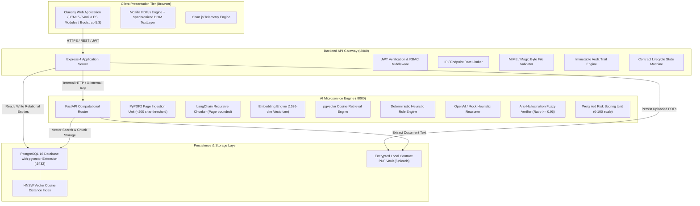
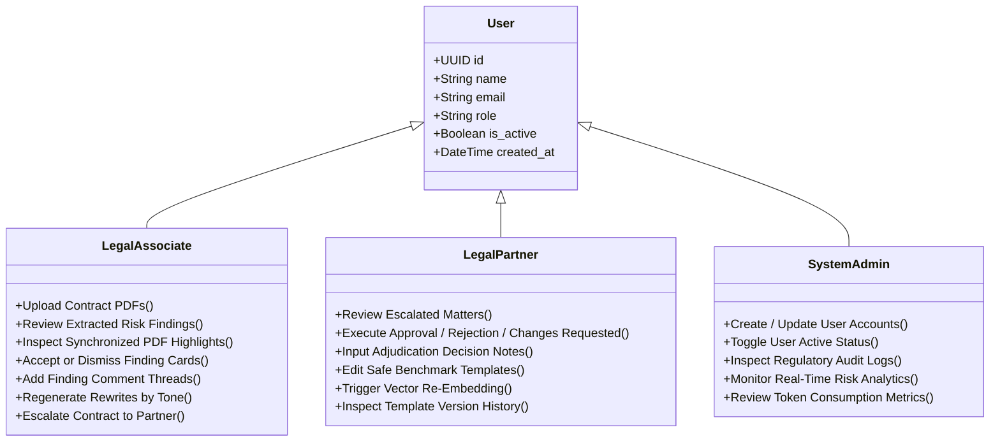
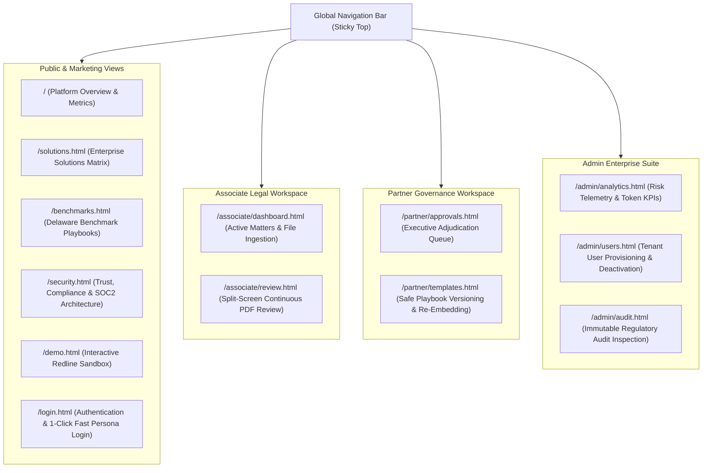
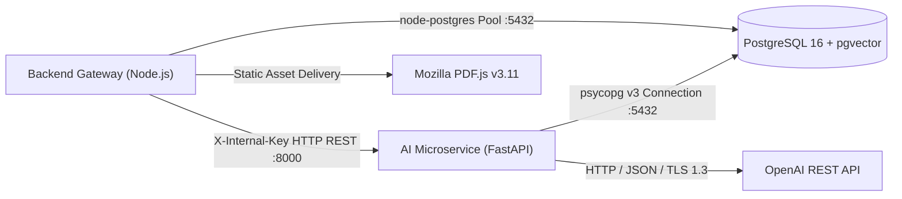
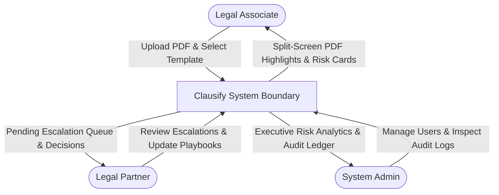
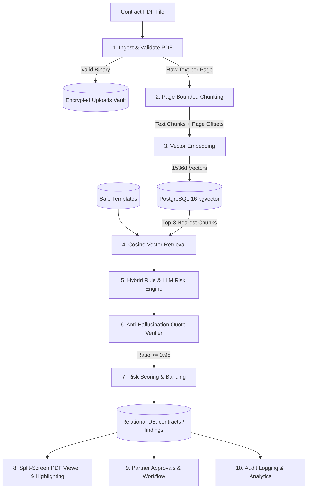
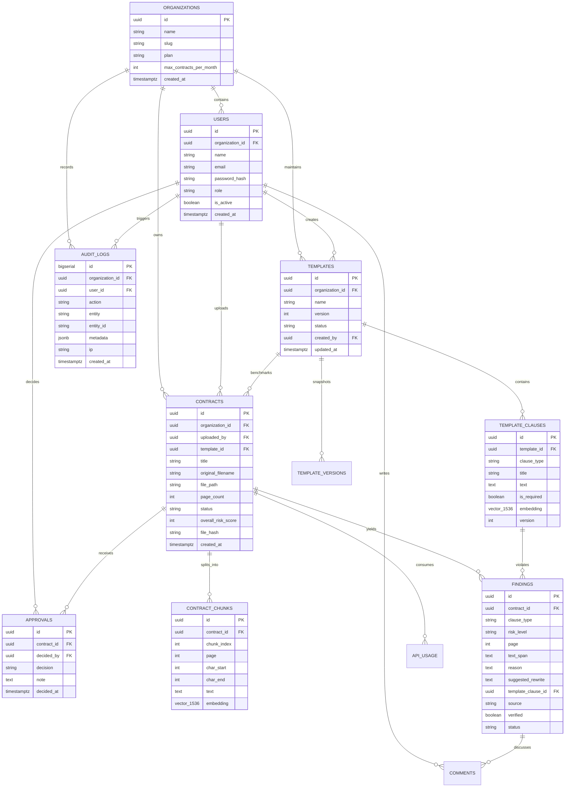
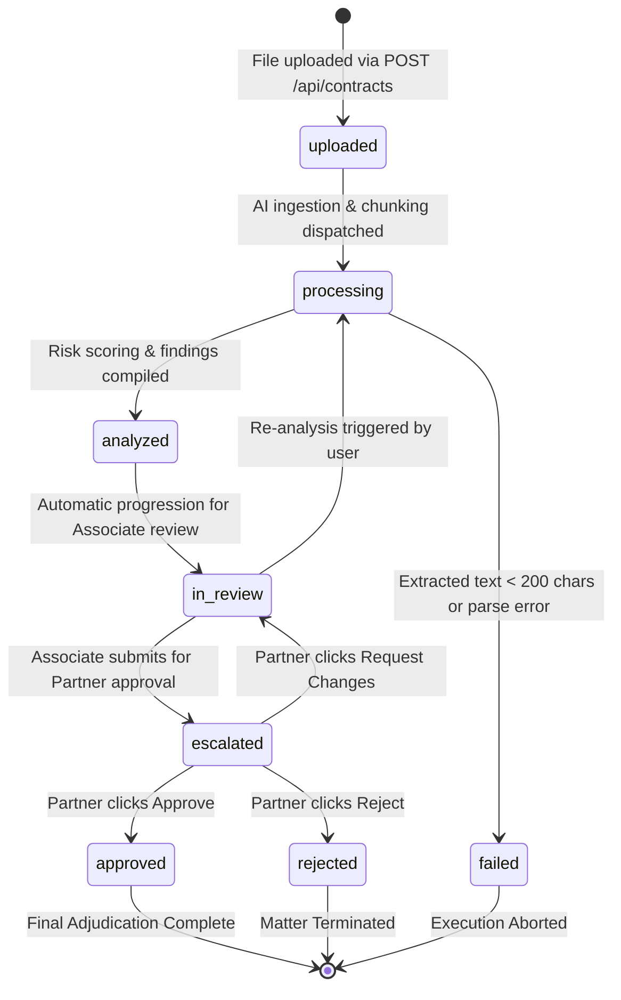

# Software Requirements Specification (SRS)
## Intelligent Legal Contract Risk & Redline Intelligence Engine (Clausify)

**Document Version:** 1.0.0  
**Status:** Approved for Implementation & Evaluation  
**Date:** November 2026  
**Standard Compliance:** IEEE Std 830-1998 / ISO/IEC/IEEE 29148:2018  

---

## Table of Contents

- [1. Introduction](#1-introduction)
  - [1.1 Purpose](#11-purpose)
  - [1.2 Document Conventions](#12-document-conventions)
  - [1.3 Intended Audience and Reading Suggestions](#13-intended-audience-and-reading-suggestions)
  - [1.4 Product Scope](#14-product-scope)
  - [1.5 Definitions, Acronyms, and Abbreviations](#15-definitions-acronyms-and-abbreviations)
- [2. Overall Description](#2-overall-description)
  - [2.1 Product Perspective](#21-product-perspective)
  - [2.2 Product Functions](#22-product-functions)
  - [2.3 User Classes and Characteristics](#23-user-classes-and-characteristics)
  - [2.4 Operating Environment](#24-operating-environment)
  - [2.5 Design and Implementation Constraints](#25-design-and-implementation-constraints)
  - [2.6 User Documentation](#26-user-documentation)
  - [2.7 Assumptions and Dependencies](#27-assumptions-and-dependencies)
- [3. External Interface Requirements](#3-external-interface-requirements)
  - [3.1 User Interfaces (UI)](#31-user-interfaces-ui)
  - [3.2 Hardware Interfaces](#32-hardware-interfaces)
  - [3.3 Software Interfaces](#33-software-interfaces)
  - [3.4 Communications Interfaces](#34-communications-interfaces)
- [4. System Features & Functional Requirements](#4-system-features--functional-requirements)
  - [4.1 System Feature Catalog](#41-system-feature-catalog)
  - [4.2 Detailed Functional Requirements](#42-detailed-functional-requirements)
    - [4.2.1 Document Ingestion & Validation Engine](#421-document-ingestion--validation-engine)
    - [4.2.2 Page-Bounded Chunking & Vectorization](#422-page-bounded-chunking--vectorization)
    - [4.2.3 Semantic Vector Retrieval & Cosine Similarity Engine](#423-semantic-vector-retrieval--cosine-similarity-engine)
    - [4.2.4 Hybrid Risk Analysis & Deviation Reasoning](#424-hybrid-risk-analysis--deviation-reasoning)
    - [4.2.5 Strict Quote Verification & Anti-Hallucination Gate](#425-strict-quote-verification--anti-hallucination-gate)
    - [4.2.6 Quantitative Risk Scoring & Severity Banding](#426-quantitative-risk-scoring--severity-banding)
    - [4.2.7 Continuous-Scroll PDF Highlighting & Bi-Directional DOM Synchronization](#427-continuous-scroll-pdf-highlighting--bi-directional-dom-synchronization)
    - [4.2.8 Clause Remediation & Multi-Tone Redline Generation](#428-clause-remediation--multi-tone-redline-generation)
    - [4.2.9 Contract Lifecycle & Multi-Tier Approval Workflow](#429-contract-lifecycle--multi-tier-approval-workflow)
    - [4.2.10 Safe Legal Benchmark Playbook Governance & Snapshotting](#4210-safe-legal-benchmark-playbook-governance--snapshotting)
    - [4.2.11 Multi-Tenant Role-Based Access Control (RBAC) & Account Governance](#4211-multi-tenant-role-based-access-control-rbac--account-governance)
    - [4.2.12 Immutable Regulatory Audit Logging & Executive Analytics](#4212-immutable-regulatory-audit-logging--executive-analytics)
    - [4.2.13 Multi-Theme Dynamic UI Architecture](#4213-multi-theme-dynamic-ui-architecture)
  - [4.3 Use Cases & Detailed User Flows](#43-use-cases--detailed-user-flows)
- [5. Non-Functional Requirements (NFRs)](#5-non-functional-requirements-nfrs)
  - [5.1 Performance Requirements](#51-performance-requirements)
  - [5.2 Safety Requirements](#52-safety-requirements)
  - [5.3 Security Requirements](#53-security-requirements)
  - [5.4 Software Quality Attributes](#54-software-quality-attributes)
  - [5.5 Business Rules & Compliance](#55-business-rules--compliance)
- [6. Appendix](#6-appendix)
  - [Appendix A: Glossary & Terminology Dictionary](#appendix-a-glossary--terminology-dictionary)
  - [Appendix B: Analysis Models](#appendix-b-analysis-models)
  - [Appendix C: Requirements Traceability Matrix (RTM)](#appendix-c-requirements-traceability-matrix-rtm)

---

## 1. Introduction

### 1.1 Purpose
This Software Requirements Specification (SRS) establishes the foundational, structural, and behavioral requirements for **Clausify** (internally designated as the *Intelligent Legal Contract Risk & Redline Intelligence Engine*). 

The target audience for this document encompasses:
1. **Academic and Institutional Evaluators**: Assessing algorithmic validity, architectural modularity, compliance standards, and verification integrity.
2. **Software Architects and Full-Stack Engineers**: Guiding system maintenance, microservice scaling, schema migrations, and frontend rendering pipeline enhancements.
3. **AI / Machine Learning Engineers**: Maintaining retrieval-augmented generation (RAG) pipelines, embedding representations, anti-hallucination verification gates, and prompt orchestration.
4. **Legal Operations Directors and General Counsel**: Reviewing risk heuristics, statutory benchmark playbooks, Delaware commercial precedent alignments, and audit-trail governance.
5. **Quality Assurance (QA) & Security Engineers**: Executing automated unit, integration, resilience, and penetration testing against defined acceptance criteria.

### 1.2 Document Conventions
This specification conforms to the **IEEE Std 830-1998** standard and the **ISO/IEC/IEEE 29148:2018** systems and software engineering requirements guidelines.

The following typographical conventions and nomenclatures are utilized throughout:
- **Bold text**: User interface components, buttons, tabs, modal windows, or database entities.
- `Monospaced text`: Source code tokens, directory paths, HTTP API endpoints, JSON payloads, SQL statements, and environment configuration parameters.
- *Italicized text*: Domain terminology, formal legal concepts, or document titles.
- **Requirement Identifiers**: Every verifiable requirement is indexed using unique functional and non-functional identifiers formatted as follows:
  - `REQ-FUNC-XXX`: Core functional requirement.
  - `REQ-NFR-XXX`: Non-functional requirement (Performance, Security, Safety, Quality).
  - `REQ-DATA-XXX`: Data entity or schema integrity requirement.
  - `REQ-IFACE-XXX`: External communication, hardware, or software interface requirement.
- **Priority Markers**:
  - `[P1 - Mandatory]`: Critical path requirement; non-negotiable for system deployment.
  - `[P2 - High Priority]`: Major operational feature required for baseline enterprise workflow.
  - `[P3 - Desirable]`: Secondary optimization or visual enhancement.

### 1.3 Intended Audience and Reading Suggestions
To facilitate efficient technical navigation, readers are advised to follow role-specific review tracks:

| Reader Persona | Primary Review Sections | Objective |
|---|---|---|
| **Academic Instructor / Evaluator** | Section 1.4, Section 2.2, Section 4.2, Section 5, Appendix B, Appendix C | Evaluate academic depth, algorithm rigor, and comprehensive requirement traceability. |
| **Backend & Cloud Engineer** | Section 2.1, Section 2.4, Section 3.3, Section 3.4, Section 4.2.1 - 4.2.12, Section 5.1 | Inspect API route contracts, database schemas, microservice authentication, and worker scalability. |
| **AI / NLP Specialist** | Section 2.2, Section 4.2.2 - 4.2.6, Section 5.1, Appendix B (Pipeline sequence) | Verify page-bounded chunking, cosine distance metrics, fuzzy quote verification, and prompt structures. |
| **Frontend / UX Engineer** | Section 3.1, Section 4.2.7, Section 4.2.13, Section 5.4 | Inspect split-screen PDF.js continuous-scroll DOM highlights and multi-theme dynamic CSS token systems. |
| **Information Security Officer** | Section 2.5, Section 3.4, Section 4.2.11, Section 4.2.12, Section 5.3, Section 5.5 | Audit role-based access control, cryptographic algorithms, immutable logging, and data privacy safeguards. |

### 1.4 Product Scope
**Clausify** is an enterprise-grade, B2B LegalTech Software-as-a-Service (SaaS) platform engineered to streamline commercial contract review, mitigate vendor liabilities, detect indemnification leakages, and generate audit-ready redlines against corporate standard safe playbooks.

#### Core Objectives
1. **Automated Risk Extraction**: Extract, parse, and analyze vendor commercial agreements in PDF format against organizational safe benchmark templates in under 3 seconds.
2. **Deterministic Anti-Hallucination**: Enforce zero-hallucination quotation verification by measuring Levenshtein and bigram fuzzy matching ratios against source text chunks, dropping any citation below a 0.95 similarity threshold.
3. **Continuous Split-Screen PDF Highlighting**: Provide bi-directional real-time synchronization between extracted risk cards and underlying DOM text layers in Mozilla PDF.js without mutating the source document.
4. **Remediation & Governance**: Provide customizable, multi-tone clause rewrites (Conservative, Balanced, Firm), an approval escalation state machine, and immutable audit logs.
5. **Universal Design Accessibility**: Deliver 6 comprehensive design themes (Claymorphism, Material You, Neo-Brutalism, Neumorphism, Glassmorphism, and Monochrome) in both Light and Dark modes.

#### Business Benefits
- **90% Latency Reduction**: Reduces first-pass legal review times from 120 minutes to under 15 seconds per contract.
- **Risk Mitigation**: Eliminates uncapped consequential liability exposures and unilateral automatic renewal traps.
- **Delaware Benchmark Standard**: Standardizes legal deviation analysis against established statutory commercial precedents.

#### System Boundaries
- **In-Scope**: Digital PDF contract ingestion, page-bounded chunking, vector embedding, cosine similarity retrieval, heuristic rule execution, LLM-driven deviation analysis, quote verification, interactive PDF highlight overlay, multi-role review workflows, safe template versioning, tenant audit logging.
- **Out-of-Scope**: Optical Character Recognition (OCR) for degraded physical scans with $<200$ characters (explicitly rejected via HTTP 422 to maintain SLA guarantees); external formal legal representation; electronic signature execution (e.g., DocuSign API integration).

### 1.5 Definitions, Acronyms, and Abbreviations

| Term / Acronym | Definition |
|---|---|
| **AC** | Acceptance Criteria established for functional verification. |
| **AES-256** | Advanced Encryption Standard using a 256-bit symmetric cryptographic key. |
| **API** | Application Programming Interface. |
| **B2B** | Business-to-Business commercial software delivery model. |
| **Banding** | Categorization of normalized risk points into qualitative risk tiers (LOW, MEDIUM, HIGH). |
| **Chunking** | Splitting raw document text into discrete character blocks while preserving page breaks. |
| **Cosine Distance** | Vector metric defined as $1 - \cos(\theta)$, expressed via the `<=>` operator in `pgvector`. |
| **Dice Coefficient** | Statistical quotient used to gauge similarity of two samples via character bigram overlap. |
| **ERD** | Entity-Relationship Diagram illustrating relational database entities and cardinalities. |
| **GDPR** | General Data Protection Regulation (Regulation (EU) 2016/679). |
| **HNSW** | Hierarchical Navigable Small World graph index for approximate nearest neighbor search. |
| **JWT** | JSON Web Token (RFC 7519) utilizing HMAC SHA-256 signatures for stateless session claims. |
| **LLM** | Large Language Model (e.g., OpenAI GPT-4o-mini, Anthropic Claude, or local reasoning models). |
| **NFR** | Non-Functional Requirement (e.g., performance, reliability, security). |
| **PDF.js** | Mozilla open-source web-standards compliant HTML5 PDF parsing and rendering library. |
| **pgvector** | Open-source vector similarity search extension for PostgreSQL. |
| **RAG** | Retrieval-Augmented Generation combining semantic vector search with generative LLM prompts. |
| **RBAC** | Role-Based Access Control enforcing privilege separation by assigned organizational role. |
| **RTM** | Requirements Traceability Matrix linking functional specifications to test executions. |
| **SOC2** | Service Organization Control 2 trust services criteria for security and confidentiality. |
| **SSE** | Server-Sent Events (RFC 6202) for unidirectional HTTP server-to-client streaming updates. |
| **TextLayer** | Transparent DOM layer overlaid on rendered PDF canvases containing accessible text spans. |
| **UUIDv4** | Universally Unique Identifier version 4 (RFC 4122) generated via cryptographically secure pseudo-random numbers. |

---

## 2. Overall Description

### 2.1 Product Perspective
Clausify operates as a distributed, microservices-based enterprise platform designed to interface seamlessly with corporate Legal Operations infrastructure. It functions independently of legacy monolithic Contract Lifecycle Management (CLM) suites while offering modular integration via RESTful JSON web services.



### 2.2 Product Functions
The high-level functional capabilities performed by Clausify comprise:
1. **Multi-Format Commercial Document Ingestion**: Ingests vendor agreements in PDF format, performs magic byte validation (`%PDF-`), enforces file integrity checks, and prevents scanning evasion.
2. **Page-Bounded Recursive Chunking**: Splits extracted document text into character spans strictly confined within single physical page boundaries, guaranteeing verbatim citation mapping.
3. **High-Dimensional Semantic Vector Embedding**: Converts document chunks and standard benchmark clauses into 1536-dimensional unit vectors stored in PostgreSQL.
4. **Sub-45ms Nearest Neighbor Vector Retrieval**: Uses HNSW cosine distance indexing (`<=>`) to retrieve relevant contract excerpts matching organizational benchmark clauses.
5. **Deterministic Heuristic Rule Enforcement**: Applies zero-tolerance regex and pattern analysis for mission-critical risk categories (unlimited liability, non-standard renewal windows, unilateral termination).
6. **Statutory Benchmark Deviation Analysis**: Compares retrieved clauses against vetted Delaware Chancery legal benchmarks using structured JSON reasoning schemas.
7. **Strict Quote Verification**: Discards citations failing a 0.95 fuzzy similarity ratio against authentic text chunks, preventing LLM fabrication.
8. **Quantitative Risk Scoring**: Computes a normalized 0 to 100 risk index weighted by clause severity multipliers and categorizes agreements into risk bands.
9. **Interactive Split-Screen PDF Highlighting**: Dynamically matches quoted excerpts to browser text layer DOM spans and synchronizes scrolling between finding cards and PDF viewports.
10. **Remediation & Redline Generation**: Generates contextual replacement clauses tailored across Conservative, Balanced, and Firm negotiation postures.
11. **Multi-Tier Approval State Machine**: Implements a strict role-based governance flow (Uploaded -> Processing -> Analyzed -> In Review -> Escalated -> Approved / Rejected).
12. **Safe Benchmark Playbook Versioning**: Allows General Counsel to modify standard clauses, triggers automated background vector re-embedding, and maintains historical JSON snapshots.
13. **Immutable Regulatory Audit Trails**: Automatically records all state transitions, file uploads, approval notes, and user mutations with client IP addresses and structured metadata.
14. **Multi-Theme Dynamic Accessibility System**: Provides instantaneous switching across 6 architectural themes in Light and Dark modes with persistent URL state synchronization.

### 2.3 User Classes and Characteristics



#### Detailed User Profiles
1. **Legal Associate (Primary Operational User)**:
   - *Technical Expertise*: Intermediate. Comfortable with web applications, legal document review software, and word processors.
   - *Usage Frequency*: Continuous daily usage during business hours.
   - *Responsibilities*: Ingesting incoming vendor contracts, reviewing extracted risk finding cards, inspecting highlighted excerpts on the continuous-scroll PDF viewer, selecting preferred negotiation rewrites, logging contextual comments, and escalating finalized analyses to supervising Partners.
2. **Legal Partner / General Counsel (Executive Adjudicator)**:
   - *Technical Expertise*: Moderate to High business domain knowledge; prefers low-friction, high-level executive interfaces.
   - *Usage Frequency*: Periodic daily usage (several times per day to review pending escalation queues).
   - *Responsibilities*: Evaluating escalated matters, reviewing associate notes, making binding approval or rejection determinations, updating organizational benchmark playbooks, and initiating background re-embedding workflows.
3. **System Administrator (IT / SecOps)**:
   - *Technical Expertise*: Advanced. Familiar with Linux environments, Docker containerization, REST APIs, and database management.
   - *Usage Frequency*: Weekly or as needed for account provisioning and compliance auditing.
   - *Responsibilities*: Provisioning user accounts, managing role assignments, deactivating compromised credentials, inspecting immutable audit logs for regulatory compliance, and monitoring AI token utilization.
4. **Public Visitor / Guest Evaluator**:
   - *Technical Expertise*: General.
   - *Usage Frequency*: Transient evaluation.
   - *Responsibilities*: Exploring public marketing overviews, testing the interactive client-side redline sandbox, inspecting statutory benchmark standards, and switching aesthetic themes.

### 2.4 Operating Environment

#### 1. Server Hardware Specifications
- **Minimum Configuration**:
  - CPU: Dual-Core 64-bit x86_64 or ARM64 processor (2.0 GHz or higher).
  - RAM: 4 GB System Memory.
  - Disk: 20 GB available SSD storage (minimum 500 MB/s sequential read for vector indexing).
- **Recommended Enterprise Production Configuration**:
  - CPU: Quad-Core or Octa-Core processor (3.0 GHz+).
  - RAM: 16 GB ECC RAM.
  - Disk: 100 GB NVMe PCIe Gen 4 storage.
  - Network: 1 Gbps Full-Duplex Ethernet.

#### 2. Software Platforms & Runtimes
- **Host Operating Systems**:
  - Linux: Ubuntu 22.04 LTS / 24.04 LTS, Debian 12, Alpine Linux 3.19.
  - Windows: Windows 11 Enterprise / Windows Server 2022 (with Docker Desktop or native runtimes).
  - macOS: macOS Sonoma 14.0+ (Apple Silicon supported).
- **Execution Runtimes**:
  - Node.js: Version 20 LTS (`v20.18.0` or higher).
  - Python: Version 3.11 or 3.12 (`v3.11.8`+).
  - Database: PostgreSQL 16.2+ running `pgvector` v0.6.0+.
  - Containerization: Docker Engine 24.0+ and Docker Compose v2.20+.

#### 3. Client Web Browsers
The user interface supports all major evergreen web browsers supporting ECMAScript 2022 (ES13) and HTML5 Canvas API:
- Google Chrome: Version 120.0 or higher.
- Microsoft Edge: Version 120.0 or higher.
- Mozilla Firefox: Version 120.0 or higher.
- Apple Safari: Version 17.0 or higher.

### 2.5 Design and Implementation Constraints

```
+-----------------------------------------------------------------------------------------+
|                               DESIGN & IMPLEMENTATION CONSTRAINTS                       |
+------------------------------------+----------------------------------------------------+
| Constraint Dimension               | Specification & Operational Enforcement            |
+------------------------------------+----------------------------------------------------+
| Architectural Decoupling           | Backend Gateway and AI Service communicate         |
|                                    | strictly over HTTP REST with shared internal auth. |
| Database Engine                    | Single unified PostgreSQL 16 database storing both |
|                                    | relational schemas and pgvector embeddings.        |
| Chunking Invariant                 | Chunks MUST NOT bridge page breaks. Chunks map     |
|                                    | deterministically to a single authentic page.      |
| Quote Verification Threshold       | Fuzzy Levenshtein / Dice ratio MUST be >= 0.95.    |
|                                    | Non-conforming quotes are rejected as hallucinated.|
| Scanned PDF Rejection              | Extracted text < 200 chars triggers HTTP 422       |
|                                    | NO_EXTRACTABLE_TEXT immediately.                   |
| Microservice Authentication        | AI microservice requires header X-Internal-Key     |
|                                    | matching backend 32-character high-entropy secret. |
| Session Token Security             | Stateless JWTs signed with HMAC SHA-256; max       |
|                                    | lifespan enforced at 8 hours.                      |
| Regulatory Compliance              | Zero training on customer data; immutable audit    |
|                                    | trail recording all entity state mutations.        |
| Zero Emoji Policy                  | Strict organizational convention: 0 emojis across  |
|                                    | code, UI text, error responses, and commit logs.   |
+------------------------------------+----------------------------------------------------+
```

### 2.6 User Documentation
The software product includes the following formal documentation artifacts:
1. **Architecture & Technical Design Specification (`ARCHITECTURE.md`)**: Comprehensive technical manual explaining vector retrieval mechanics, component boundaries, and state transitions.
2. **Operations & Quickstart Manual (`README.md`)**: Detailed operational guide covering Docker Compose execution, manual environment configuration, database seeding, and 5-step end-to-end demo walkthroughs.
3. **One-Click Automation Launchers**:
   - `run.bat` / `start.bat`: Automated multi-process startup script for Windows environments.
   - `stop.bat`: Clean termination utility for running background services.
4. **Interactive REST API Documentation**:
   - FastAPI Interactive Swagger Interface: Accessible at `http://localhost:8000/docs`.
   - Postman API Collection: Exported collection file located at `postman/clausify_collection.json`.
5. **Acceptance Criteria Verification Harness (`scripts/verify_acceptance_criteria.js`)**: Executable test suite validating Acceptance Criteria AC 1 through AC 12 against running environments.

### 2.7 Assumptions and Dependencies
1. **Document Fidelity**: Uploaded contract agreements are assumed to be digital-native PDF documents containing extractable text layers. Scanned or image-only documents are assumed out-of-scope for real-time analysis.
2. **Network Clock Synchronization**: System servers and client browsers maintain time synchronization via Network Time Protocol (NTP) to ensure valid JWT token evaluation.
3. **External LLM Provider Availability**: When configured with `LLM_PROVIDER=openai`, external network access to `https://api.openai.com/v1` is assumed. If internet access is unavailable, the system depends on its internal deterministic `MOCK` provider with 100% feature parity.
4. **Filesystem Permissions**: The backend process requires read and write access to the `./uploads` directory on the host server.

---

## 3. External Interface Requirements

### 3.1 User Interfaces (UI)

#### 1. Screen Hierarchy & Navigation Layout
The Clausify web interface follows a modular, responsive desktop layout optimized for high-density legal document analysis.



#### 2. Key Screen Mockup Specifications

##### A. Split-Screen Review Workspace (`/associate/review.html`)
- **Viewport Layout**: 50/50 horizontal flex container occupying 100% viewport height below the global navbar.
- **Left Pane (PDF Viewer)**:
  - Top Toolbar: Page navigation (`#currentPageInput`, `#pageCountLabel`), zoom controls (`#zoomInBtn`, `#zoomOutBtn`, `#zoomLevel`), search bar (`#searchPdfInput`), and export report button (`#exportReportBtn`).
  - Document Viewport (`#pdfContainer`): Continuous-scroll container rendering all document pages sequentially. Each page consists of a `<canvas>` element overlaid with an absolute-positioned `<div class="textLayer">`.
  - Highlight Overlays: DOM text spans matching finding quotes receive the `.pdf-highlight` class with severity-specific background hues (`.pdf-highlight-high`: `#EF4444`, `.pdf-highlight-medium`: `#F59E0B`, `.pdf-highlight-low`: `#10B981`).
- **Right Pane (Risk & Remediation Panel)**:
  - Top Metrics Bar: Overall Risk Score Gauge (0-100 dial), Qualitative Risk Badge (`HIGH`, `MEDIUM`, `LOW`), and category distribution pills.
  - Filter Bar: Interactive toggle pills filtering findings by severity (`All`, `High`, `Medium`, `Low`) and status (`Open`, `Accepted`, `Dismissed`).
  - Finding Card List (`#findingsList`): Scrollable list of expandable cards detailing:
    - Clause type label and verified page badge (`Page X - Verbatim Quote`).
    - Exact extracted quote excerpt.
    - AI risk reasoning narrative.
    - Standard benchmark comparison.
    - Tone-selectable suggested rewrite (Conservative, Balanced, Firm).
    - Action buttons: **Copy Rewrite**, **Regenerate**, **Accept**, **Dismiss**, and **Comment**.
  - Bottom Action Strip: **Submit for Partner Approval** button (transitions contract state to `escalated`).

##### B. Safe Template Manager (`/partner/templates.html`)
- **Master-Detail Layout**:
  - Left List Group: Active benchmark playbooks (e.g., *Standard Safe Vendor Template v1*, *Enterprise SaaS Agreement Standard*).
  - Right Editor Panel: Expandable accordion containing 6 standard statutory clause types (Limitation of Liability, Indemnification, Termination for Cause, Payment Terms, Automatic Renewal, Warranties & Disclaimers).
  - Clause Editor Form: Rich text textarea allowing Partners to calibrate safe legal benchmark text and set mandatory enforcement flags.
  - Snapshot Control: **Save & Re-embed** button invoking background embedding recalculation, incrementing the version counter (`v1 -> v2`), and capturing a snapshot in `template_versions`.

##### C. Executive Telemetry Suite (`/admin/analytics.html`)
- **KPI Summary Grid**: 4 top cards displaying Total Contracts Ingested, High Risk Contracts, Average Portfolio Risk Score, and Active Reviewers.
- **Data Visualizations (Chart.js)**:
  - Ingestion Velocity Bar Chart (`#ingestionChart`): Monthly contract processing volumes.
  - Risk Distribution Donut Chart (`#riskDistributionChart`): Ratio of High vs. Medium vs. Low risk contracts.
  - API Token Consumption Telemetry (`#tokenUsageChart`): Input vs. Output token allocation across embedding and LLM workloads.

#### 3. UX Design Standards & Theme System
The UI implements 6 distinct design presets rendered via CSS Custom Properties (`var(--...)`) conforming to WCAG 2.1 AA contrast requirements:
1. **Claymorphism**: Soft 3D volumetric surfaces, dual inset highlights, organic border radii (16px), floating card elevation.
2. **Material You**: Dynamic tonal palettes, pill-shaped interactive chips, elevation-based surface tinting, modern font tracking.
3. **Neo-Brutalism**: High-contrast solid black borders (2.5px solid `#000`), hard non-blurred pop drop shadows (`4px 4px 0px #000`), vivid retro accent backgrounds.
4. **Neumorphism**: Embossed soft dual shadows (extruded light/shadow pairing), low-contrast tactile plastic surfaces.
5. **Glassmorphism**: Frosted acrylic glass backdrops (`backdrop-filter: blur(16px)`), translucent pastel borders, ambient gradient mesh background.
6. **Monochrome**: Swiss editorial minimalist black-and-white aesthetic, strict typography hierarchy, geometric border dividers.

### 3.2 Hardware Interfaces
Clausify does not directly control physical hardware or specialized embedded devices. It interfaces with standard computing hardware over virtualized network controllers:
- **Processor Architectures**: Standard x86_64 (Intel Xeon / AMD EPYC) and ARM64 (Apple Silicon, AWS Graviton) processors.
- **Storage Subsystems**: High-IOPS solid-state storage (NVMe) accessed via the host operating system's standard POSIX filesystem interface.
- **Network Interface**: Ethernet controller supporting TCP/IP network traffic across standard enterprise ports (80, 443, 3000, 5432, 8000).

### 3.3 Software Interfaces



#### 1. Database Management System (DBMS)
- **Engine**: PostgreSQL version 16.2 or higher.
- **Driver / ORM**:
  - Backend: `pg` (`node-postgres` v8.11+) connection pool with parameterized SQL execution.
  - AI Service: `psycopg` (v3.1+) supporting binary vector transfers.
- **Extensions**: `uuid-ossp`, `pgcrypto`, `vector` (pgvector v0.6.0+).

#### 2. Foundation Model & LLM Interfaces
- **External Provider**: OpenAI API v1 (`https://api.openai.com/v1`).
  - Embedding Endpoint: `POST /v1/embeddings` utilizing model `text-embedding-3-small` (1536 dimensions).
  - Reasoning Endpoint: `POST /v1/chat/completions` utilizing model `gpt-4o-mini` with `response_format: { type: "json_object" }`.
- **Internal Fallback Provider**: Deterministic Mock Heuristic Engine (`MOCK`).
  - Generates deterministic 1536-dimensional unit vectors using trigonometric seed hashing.
  - Evaluates clause risk using deterministic statutory regex pattern analyzers.

#### 3. Client Libraries
- **Mozilla PDF.js (v3.11.174)**: Embedded client-side PDF renderer parsing binary PDF streams into HTML5 Canvas and accessible text layer DOM spans.
- **Chart.js (v4.4.1)**: Canvas-based charting library rendering executive telemetry and risk distribution graphics.
- **Bootstrap (v5.3.3)**: CSS framework providing grid layout, utility classes, and modal dialog controllers.

### 3.4 Communications Interfaces
1. **Client-to-Backend Gateway Communication**:
   - Protocol: HTTPS / TLS 1.3 over TCP port 3000 (or port 443 in production reverse proxy configurations).
   - Data Format: Application JSON (`application/json`) for command and control endpoints; Multi-Part Form Data (`multipart/form-data`) for contract PDF binary uploads.
   - Authentication Scheme: HTTP `Authorization: Bearer <JWT>` header on all protected resources.
   - Real-Time Updates: Server-Sent Events (`text/event-stream`) via `/api/contracts/:id/progress` and polling fallbacks (`/api/contracts/:id`).
2. **Backend Gateway to AI Microservice Communication**:
   - Protocol: HTTP/1.1 REST over private container networking (default port 8000).
   - Security Header: `X-Internal-Key: <INTERNAL_API_KEY>`. Requests lacking this header or presenting an invalid key are rejected with HTTP 403 Forbidden.
3. **Database Network Protocol**:
   - Protocol: PostgreSQL Wire Protocol 3.0 over TCP port 5432 with mandatory password authentication.

---

## 4. System Features & Functional Requirements

### 4.1 System Feature Catalog

| Feature Code | Feature Name | Description | Priority |
|---|---|---|---|
| **FEAT-01** | Document Ingestion & Validation | Validates, verifies, and stores commercial agreement PDFs. | P1 |
| **FEAT-02** | Page-Bounded Chunking | Chunks extracted text strictly within physical page breaks. | P1 |
| **FEAT-03** | Semantic Vector Retrieval | Logarithmic nearest-neighbor search via `pgvector` HNSW index. | P1 |
| **FEAT-04** | Hybrid Risk Analysis Engine | Executes deterministic rules and LLM clause deviation reasoning. | P1 |
| **FEAT-05** | Strict Quote Verification | Validates extracted quotes against raw source text ($\ge 0.95$ threshold). | P1 |
| **FEAT-06** | Quantitative Risk Scoring | Normalizes contract risk to 0-100 scale across risk bands. | P1 |
| **FEAT-07** | Continuous-Scroll PDF Highlighting | Bi-directional synchronization between finding cards and PDF spans. | P1 |
| **FEAT-08** | Multi-Tone Clause Remediation | Generates audit-ready redlines across Conservative, Balanced, and Firm tones. | P2 |
| **FEAT-09** | Contract Review & Approval Workflow | State machine managing Associate escalation and Partner adjudication. | P1 |
| **FEAT-10** | Safe Template Playbook Governance | Enables General Counsel to edit standard clauses and re-embed. | P2 |
| **FEAT-11** | Multi-Tenant RBAC & User Administration| Governs organizational privilege boundaries and user deactivation. | P1 |
| **FEAT-12** | Immutable Regulatory Audit Logging | Append-only ledger recording all state mutations and access records. | P1 |
| **FEAT-13** | Multi-Theme Accessibility Architecture | Renders 6 distinct visual themes in Light and Dark modes. | P2 |

---

### 4.2 Detailed Functional Requirements

#### 4.2.1 Document Ingestion & Validation Engine
- **Identifier**: `REQ-FUNC-INGEST`
- **Priority**: `[P1 - Mandatory]`
- **Description**: The system shall accept, validate, and securely persist uploaded commercial contracts in PDF format.
- **Stimulus/Response Sequences**:
  1. *Stimulus*: Legal Associate submits `POST /api/contracts` with a multi-part payload containing a contract file and an active `template_id`.
  2. *Response*: System verifies MIME type and magic bytes (`%PDF-`), generates a UUIDv4 contract ID, writes the file to the encrypted upload vault, writes an initial database record with status `uploaded`, dispatches an asynchronous background ingestion job to the AI service, and returns HTTP 202 Accepted.
- **Detailed Requirements**:
  - `REQ-FUNC-INGEST-001`: The system MUST validate that the uploaded file contains the `%PDF-` magic byte sequence at byte offset 0. Files failing this check MUST be rejected with HTTP 400 `INVALID_FILE_TYPE`.
  - `REQ-FUNC-INGEST-002`: The system MUST enforce a maximum file size limit of 25 megabytes. Uploads exceeding this threshold MUST be rejected with HTTP 413 `FILE_TOO_LARGE`.
  - `REQ-FUNC-INGEST-003`: The system MUST generate a SHA-256 cryptographic checksum of the uploaded file and record it in `contracts.file_hash`.
  - `REQ-FUNC-INGEST-004`: Upon receiving the document, the AI microservice MUST extract text page-by-page using `PyPDF2`. If the cumulative extracted character count across all pages is $< 200$, the ingestion MUST immediately fail with HTTP 422 `NO_EXTRACTABLE_TEXT` to prevent OCR bypass attempts.

#### 4.2.2 Page-Bounded Chunking & Vectorization
- **Identifier**: `REQ-FUNC-CHUNK`
- **Priority**: `[P1 - Mandatory]`
- **Description**: The system shall partition extracted text into semantic chunks while strictly preserving document page boundaries.
- **Stimulus/Response Sequences**:
  1. *Stimulus*: AI microservice completes raw text extraction for an uploaded contract.
  2. *Response*: Chunker executes recursive character splitting per page, records page numbers, calculates character offsets, generates vector embeddings, and stores records in `contract_chunks`.
- **Detailed Requirements**:
  - `REQ-FUNC-CHUNK-001`: Text chunking MUST be executed strictly within single page limits. Under no circumstances shall a chunk span across a physical page boundary.
  - `REQ-FUNC-CHUNK-002`: The target chunk size MUST be calibrated to 1000 characters with an overlap window of 200 characters using `RecursiveCharacterTextSplitter`.
  - `REQ-FUNC-CHUNK-003`: Every chunk record stored in `contract_chunks` MUST record the authentic physical `page` number, `char_start` offset, `char_end` offset, and `chunk_index`.
  - `REQ-FUNC-CHUNK-004`: Each chunk MUST be vectorized into a 1536-dimensional unit vector and persisted in `contract_chunks.embedding`.
  - `REQ-FUNC-CHUNK-005`: Document chunking MUST be idempotent: re-ingesting a document MUST completely purge existing chunks for that `contract_id` before inserting new chunks.

#### 4.2.3 Semantic Vector Retrieval & Cosine Similarity Engine
- **Identifier**: `REQ-FUNC-RETR`
- **Priority**: `[P1 - Mandatory]`
- **Description**: The system shall retrieve contract chunks semantically relevant to organizational safe benchmark clauses using approximate nearest neighbor vector search.
- **Stimulus/Response Sequences**:
  1. *Stimulus*: Risk analysis pipeline evaluates a specific benchmark clause type (e.g., *Limitation of Liability*).
  2. *Response*: System queries PostgreSQL for the top $K$ nearest contract chunks using the cosine distance operator `<=>` and passes matches to the analysis engine.
- **Detailed Requirements**:
  - `REQ-FUNC-RETR-001`: Vector similarity search MUST use the cosine distance operator `<=>` against the HNSW index on `contract_chunks.embedding`.
  - `REQ-FUNC-RETR-002`: For each evaluated safe template clause, the system MUST retrieve the top $K=3$ most similar contract chunks.
  - `REQ-FUNC-RETR-003`: Retrieval queries MUST filter strictly by `contract_id` to guarantee multi-tenant and multi-contract isolation.
  - `REQ-FUNC-RETR-004`: The vector query execution latency for a top-3 nearest neighbor search over 50,000 chunks MUST NOT exceed 45 milliseconds.

#### 4.2.4 Hybrid Risk Analysis & Deviation Reasoning
- **Identifier**: `REQ-FUNC-ANLZ`
- **Priority**: `[P1 - Mandatory]`
- **Description**: The system shall execute a hybrid risk evaluation combining deterministic heuristic rules and generative legal deviation analysis.
- **Stimulus/Response Sequences**:
  1. *Stimulus*: Retrieved chunks and safe benchmark clauses are loaded into the risk evaluation pipeline.
  2. *Response*: Heuristic rules execute first; LLM analysis evaluates remaining semantic nuances; findings are structured into standardized risk objects.
- **Detailed Requirements**:
  - `REQ-FUNC-ANLZ-001`: The system MUST evaluate deterministic regex-based rules for high-liability indicators, including:
    - Unlimited liability provisions (`unlimited liability`, `sole liability`, `no cap`).
    - Unilateral auto-renewal terms (`automatically renew`, `consecutive terms without notice`).
    - Immediate unilateral termination (`terminate without cause on zero days`).
  - `REQ-FUNC-ANLZ-002`: Chunks triggering deterministic rules MUST generate immediate `findings` marked with `source = 'rule'`.
  - `REQ-FUNC-ANLZ-003`: The system MUST prompt the reasoning engine with the retrieved contract text, safe benchmark requirement, and Delaware legal standard. The LLM MUST return a valid JSON object matching the schema:
    ```json
    {
      "clause_type": "string",
      "risk_level": "LOW | MEDIUM | HIGH",
      "quote": "string",
      "reason": "string",
      "suggested_rewrite": "string"
    }
    ```
  - `REQ-FUNC-ANLZ-004`: If the LLM generates malformed JSON or fails to respond within 30 seconds, the resilient retry adapter MUST retry with exponential backoff (up to 3 attempts) before failing safely.

#### 4.2.5 Strict Quote Verification & Anti-Hallucination Gate
- **Identifier**: `REQ-FUNC-VERF`
- **Priority**: `[P1 - Mandatory]`
- **Description**: The system shall verify all LLM-extracted quotes against authentic source document text, completely eliminating hallucinated citations.
- **Stimulus/Response Sequences**:
  1. *Stimulus*: LLM returns a candidate finding containing a proposed quote string.
  2. *Response*: Verification unit executes fuzzy sliding-window comparison against retrieved chunks; if similarity is $\ge 0.95$, finding is accepted; otherwise, finding is discarded.
- **Detailed Requirements**:
  - `REQ-FUNC-VERF-001`: The system MUST compute the fuzzy similarity ratio between the candidate quote string and the raw chunk text using Levenshtein distance normalized by string length and character bigram Dice coefficient:
    $$\text{Ratio}(Q, S) = \max_{w \in \text{Windows}(S)} \left[ \frac{2 \times |\text{Bigrams}(Q) \cap \text{Bigrams}(w)|}{|\text{Bigrams}(Q)| + |\text{Bigrams}(w)|} \right]$$
  - `REQ-FUNC-VERF-002`: If $\text{Ratio}(Q, S) \ge 0.95$, the quote MUST be marked `verified = true`, and the physical page number MUST be derived directly from the verified chunk metadata.
  - `REQ-FUNC-VERF-003`: If $\text{Ratio}(Q, S) < 0.95$, the candidate finding MUST be dropped as an ungrounded hallucination and logged in debug telemetry.
  - `REQ-FUNC-VERF-004`: Findings sourced from deterministic rules (`source = 'rule'`) MUST automatically qualify as verified (`verified = true`).

#### 4.2.6 Quantitative Risk Scoring & Severity Banding
- **Identifier**: `REQ-FUNC-SCOR`
- **Priority**: `[P1 - Mandatory]`
- **Description**: The system shall compute a normalized contract risk score from 0 to 100 based on weighted clause risk severity points.
- **Stimulus/Response Sequences**:
  1. *Stimulus*: All verified findings for a contract are compiled.
  2. *Response*: Scoring engine calculates total weighted points, normalizes to a 100-point scale, determines the risk band, and updates `contracts.overall_risk_score`.
- **Detailed Requirements**:
  - `REQ-FUNC-SCOR-001`: The system MUST assign the following base penalty weights to findings:
    - `LOW` Risk finding: 1 point.
    - `MEDIUM` Risk finding: 3 points.
    - `HIGH` Risk finding: 5 points.
  - `REQ-FUNC-SCOR-002`: The overall contract risk score MUST be normalized to an integer scale between 0 and 100 using the following formula:
    $$\text{RawScore} = \sum_{f \in \text{Findings}} \text{Weight}(f.\text{risk\_level})$$
    $$\text{OverallScore} = \min\left(100, \text{Round}\left(\frac{\text{RawScore}}{\text{MaxBaselineScore}} \times 100\right)\right)$$
    *(Where $\text{MaxBaselineScore} = 25$ points).*
  - `REQ-FUNC-SCOR-003`: The system MUST classify the contract into one of three qualitative risk bands:
    - **LOW RISK**: 0 – 33.
    - **MEDIUM RISK**: 34 – 66.
    - **HIGH RISK**: 67 – 100.
  - `REQ-FUNC-SCOR-004`: If a contract yields zero findings, its score MUST be recorded as 0 with risk band `LOW`.

#### 4.2.7 Continuous-Scroll PDF Highlighting & Bi-Directional DOM Synchronization
- **Identifier**: `REQ-FUNC-PDFH`
- **Priority**: `[P1 - Mandatory]`
- **Description**: The system shall render continuous-scroll PDF canvases with overlaid transparent textLayer spans, highlight extracted quotes in place, and support bi-directional viewport synchronization.
- **Stimulus/Response Sequences**:
  1. *Stimulus*: User opens the split-screen review page (`/associate/review.html?id=...`).
  2. *Response*: System streams contract PDF, renders pages sequentially via PDF.js, executes `findQuoteMatches()` across text layer spans, applies severity CSS highlight classes, and binds click listeners.
- **Detailed Requirements**:
  - `REQ-FUNC-PDFH-001`: The system MUST render all document pages continuously within `#pdfContainer` without requiring manual page flipping.
  - `REQ-FUNC-PDFH-002`: The pure function `findQuoteMatches(textItems, quoteText)` MUST normalize whitespace and locate text span boundaries corresponding to verified quotes.
  - `REQ-FUNC-PDFH-003`: Matching text spans in the DOM textLayer MUST receive the CSS class `.pdf-highlight` along with severity classes (`.pdf-highlight-high`, `.pdf-highlight-medium`, `.pdf-highlight-low`).
  - `REQ-FUNC-PDFH-004`: When a user clicks a finding card in the right pane, the left PDF viewport MUST scroll smoothly to the target page and trigger a 1.5-second pulsing animation on the target highlight.
  - `REQ-FUNC-PDFH-005`: When a user clicks a highlighted text span in the PDF viewer, the right findings panel MUST scroll to and visually focus the corresponding finding card.

#### 4.2.8 Clause Remediation & Multi-Tone Redline Generation
- **Identifier**: `REQ-FUNC-REMD`
- **Priority**: `[P2 - High Priority]`
- **Description**: The system shall generate contextual, audit-ready replacement language for flagged clauses tailored across distinct negotiation postures.
- **Stimulus/Response Sequences**:
  1. *Stimulus*: Legal Associate selects a negotiation posture (Conservative, Balanced, Firm) and clicks **Regenerate Rewrite**.
  2. *Response*: AI service generates an amended clause aligned with the chosen posture, updates the finding record, and presents the rewrite in the card.
- **Detailed Requirements**:
  - `REQ-FUNC-REMD-001`: The system MUST support three negotiation postures:
    - **Conservative**: Minimalist edits conforming strictly to legal minimums with lowest vendor pushback risk.
    - **Balanced**: Standard mutual parity terms reflecting typical commercial market standards.
    - **Firm**: Customer-favorable terms maximizing liability disclaimers, audit rights, and termination flexibility.
  - `REQ-FUNC-REMD-002`: The finding card MUST provide a one-click **Copy Rewrite** button copying the clean suggested language to the system clipboard.
  - `REQ-FUNC-REMD-003`: The finding card MUST provide **Accept** and **Dismiss** status buttons, updating `findings.status` to `accepted` or `dismissed`.

#### 4.2.9 Contract Lifecycle & Multi-Tier Approval Workflow
- **Identifier**: `REQ-FUNC-WORKFLOW`
- **Priority**: `[P1 - Mandatory]`
- **Description**: The system shall enforce a state machine governing contract progression from initial upload through Partner adjudication.
- **Stimulus/Response Sequences**:
  1. *Stimulus*: Legal Associate completes review and clicks **Submit for Partner Approval**.
  2. *Response*: Contract state mutates to `escalated`, an audit log entry is written, and the matter appears in the Partner approval queue.
  3. *Stimulus*: Legal Partner reviews matter on `/partner/approvals.html` and clicks **Approve**, **Reject**, or **Request Changes**.
  4. *Response*: Contract state transitions accordingly, an immutable decision record is inserted into `approvals`, and the contract lifecycle completes.
- **Detailed Requirements**:
  - `REQ-FUNC-WORKFLOW-001`: The contract lifecycle MUST strictly follow the state transitions:
    $$\text{uploaded} \rightarrow \text{processing} \rightarrow \text{analyzed} \rightarrow \text{in\_review} \rightarrow \text{escalated} \rightarrow (\text{approved} \mid \text{rejected} \mid \text{in\_review})$$
  - `REQ-FUNC-WORKFLOW-002`: Only users possessing the `associate`, `partner`, or `admin` role shall be authorized to transition a contract from `in_review` to `escalated`.
  - `REQ-FUNC-WORKFLOW-003`: Only users possessing the `partner` or `admin` role shall be authorized to transition a contract from `escalated` to `approved` or `rejected`.
  - `REQ-FUNC-WORKFLOW-004`: Partner approval or rejection submissions MUST capture an optional written justification note in `approvals.note`.
  - `REQ-FUNC-WORKFLOW-005`: If a contract analysis fails during ingestion or processing, the state MUST transition to `failed` with a descriptive error recorded in `contracts.failure_reason`.

#### 4.2.10 Safe Legal Benchmark Playbook Governance & Snapshotting
- **Identifier**: `REQ-FUNC-TMPL`
- **Priority**: `[P2 - High Priority]`
- **Description**: The system shall allow authorized Partners to manage corporate safe benchmark clauses, capture historical version snapshots, and trigger vector re-embedding.
- **Stimulus/Response Sequences**:
  1. *Stimulus*: Legal Partner modifies benchmark clause text on `/partner/templates.html` and clicks **Save & Re-embed**.
  2. *Response*: System archives previous state into `template_versions`, increments template version (`v1 -> v2`), updates `template_clauses`, triggers background vector re-embedding, and returns HTTP 200.
- **Detailed Requirements**:
  - `REQ-FUNC-TMPL-001`: Only users with role `partner` or `admin` shall be permitted to create, update, or archive templates.
  - `REQ-FUNC-TMPL-002`: Every modification to a template MUST automatically capture a complete JSON snapshot in `template_versions` containing all clause texts, timestamps, and the mutating user's ID.
  - `REQ-FUNC-TMPL-003`: Updating a template clause MUST trigger vector re-embedding of the updated text and persist the new 1536-dimensional vector in `template_clauses.embedding`.
  - `REQ-FUNC-TMPL-004`: The system MUST support version inspection: users shall be able to view historical snapshot diffs via `GET /api/templates/:id/versions`.

#### 4.2.11 Multi-Tenant Role-Based Access Control (RBAC) & Account Governance
- **Identifier**: `REQ-FUNC-RBAC`
- **Priority**: `[P1 - Mandatory]`
- **Description**: The system shall enforce strict multi-tenant data isolation and role-based authorization across all endpoints.
- **Stimulus/Response Sequences**:
  1. *Stimulus*: User submits credentials to `POST /api/auth/login`.
  2. *Response*: System verifies password hash with `bcrypt`, evaluates `is_active` flag, issues an 8-hour JWT carrying `userId`, `role`, and `organizationId`, and records `last_login_at`.
- **Detailed Requirements**:
  - `REQ-FUNC-RBAC-001`: The system MUST enforce the following role privileges:
    - `associate`: Upload contracts, review findings, accept/dismiss findings, post comments, escalate matters.
    - `partner`: All associate permissions + approve/reject matters + manage benchmark templates + view version history.
    - `admin`: All partner permissions + user CRUD + toggle account active status + inspect audit logs + view system analytics.
  - `REQ-FUNC-RBAC-002`: User passwords MUST be hashed using `bcrypt` with a minimum cost factor of 10 prior to database insertion.
  - `REQ-FUNC-RBAC-003`: When an administrator deactivates a user (`is_active = false`), any subsequent API requests from that user MUST be rejected immediately with HTTP 401 Unauthorized.
  - `REQ-FUNC-RBAC-004`: All database queries for contracts, templates, and findings MUST be scoped to the authenticated user's `organization_id` to prevent cross-tenant data leakage.

#### 4.2.12 Immutable Regulatory Audit Logging & Executive Analytics
- **Identifier**: `REQ-FUNC-AUDT`
- **Priority**: `[P1 - Mandatory]`
- **Description**: The system shall maintain an append-only, tamper-resistant audit trail recording all security and lifecycle events.
- **Stimulus/Response Sequences**:
  1. *Stimulus*: Any state mutation occurs (file upload, status transition, approval decision, user modification, template update).
  2. *Response*: System asynchronously inserts an audit record into `audit_logs` capturing user ID, action name, target entity, client IP address, timestamp, and JSON metadata.
- **Detailed Requirements**:
  - `REQ-FUNC-AUDT-001`: The `audit_logs` table MUST be append-only. Under no circumstances shall `UPDATE` or `DELETE` operations be permitted on `audit_logs`.
  - `REQ-FUNC-AUDT-002`: Every audit log record MUST capture the originating client IP address, action string, target entity type, entity ID, and JSONB metadata.
  - `REQ-FUNC-AUDT-003`: System Administrators shall be able to filter and inspect audit logs via `GET /api/admin/audit` by date range, action type, user ID, and entity.
  - `REQ-FUNC-AUDT-004`: The system MUST record token consumption metrics in `api_usage` for all embedding and LLM calls, calculating input and output token counts for billing telemetry.

#### 4.2.13 Multi-Theme Dynamic UI Architecture
- **Identifier**: `REQ-FUNC-THME`
- **Priority**: `[P2 - High Priority]`
- **Description**: The system shall provide real-time aesthetic theme switching across 6 architectural presets in Light and Dark modes with URL query persistence.
- **Stimulus/Response Sequences**:
  1. *Stimulus*: User clicks a theme preset in the navigation theme selector dropdown.
  2. *Response*: System sets `data-theme` attribute on `<html>`, updates `localStorage`, synchronizes the current label, updates active indicators, updates URL query parameter via `window.history.replaceState`, and dispatches a `themechanged` DOM event.
- **Detailed Requirements**:
  - `REQ-FUNC-THME-001`: The system MUST support the following 6 canonical theme presets:
    1. `claymorphism` (Soft 3D & Bubbly, baseline design).
    2. `material-you` (Google M3 Dynamic Tonal).
    3. `neo-brutalism` (Bold Black Borders & Hard Pop Shadows).
    4. `neumorphism` (Embossed Dual-Shadow Plastic).
    5. `glassmorphism` (Frosted Glass Acrylic & Ambient Mesh).
    6. `monochrome` (Minimalist Swiss Editorial).
  - `REQ-FUNC-THME-002`: All 6 themes MUST fully support both `light` and `dark` modes via the `data-mode` and `data-bs-theme` attributes.
  - `REQ-FUNC-THME-003`: Selecting a theme MUST explicitly update the button display label to the exact theme name (e.g., *Claymorphism*, *Neo-Brutalism*).
  - `REQ-FUNC-THME-004`: When a user selects a theme or mode, the system MUST synchronize URL parameters (`?theme=...&mode=...`) using `window.history.replaceState` so browser reloads maintain user selections.

---

### 4.3 Use Cases & Detailed User Flows

#### Use Case 1: Ingest Commercial Agreement & Perform AI Risk Analysis
- **Primary Actor**: Legal Associate (`associate@demo.com`).
- **Preconditions**: Associate is authenticated; standard safe template is active in the organization.
- **Trigger**: Associate drops `contract_risky_1.pdf` into upload zone on `/associate/dashboard.html` and clicks **Upload & Run AI Risk Analysis**.
- **Main Success Scenario**:
  1. Frontend submits `multipart/form-data` payload to `POST /api/contracts`.
  2. Gateway validates PDF magic bytes, creates contract record (`status = 'uploaded'`), and responds with HTTP 202.
  3. Gateway calls AI service `POST /ingest` with file path.
  4. AI service extracts text per page, validates text length $\ge 200$ chars, chunks text within page boundaries, generates 1536d embeddings, and stores records in `contract_chunks`.
  5. Gateway updates contract status to `processing` and calls AI service `POST /analyze`.
  6. AI service retrieves nearest chunks for each template clause using pgvector cosine distance `<=>`.
  7. AI service evaluates heuristic rules and prompts LLM for deviation analysis.
  8. Anti-hallucination verifier checks fuzzy similarity ($\ge 0.95$); verified findings are inserted into `findings`.
  9. AI service calculates weighted risk score (e.g., 78/100) and marks contract `analyzed`.
  10. Gateway updates status to `in_review`. Associate dashboard updates in real time via polling/SSE to display the 78/100 High Risk badge.
- **Alternative Flow - Scanned Document**:
  - In Step 4, cumulative extracted text is $< 200$ chars.
  - AI service rejects file with HTTP 422 `NO_EXTRACTABLE_TEXT`.
  - Gateway transitions contract to `failed` with failure reason *"Extracted only X characters. Scanned PDF detected."*.
  - Frontend displays error alert directing user to supply a digital text PDF.

#### Use Case 2: Interactive Redline Remediation & Partner Escalation
- **Primary Actor**: Legal Associate.
- **Preconditions**: Contract is in `in_review` state with extracted findings.
- **Trigger**: Associate clicks **Review** on the contract row.
- **Main Success Scenario**:
  1. Browser loads `/associate/review.html?id=...`.
  2. PDF.js streams document binary, rendering pages and text layers continuously in left pane.
  3. Findings panel loads verified findings and Overall Risk Score dial in right pane.
  4. Script executes `findQuoteMatches()`, applying `.pdf-highlight-high` classes to matching text layer spans.
  5. Associate clicks finding card *Unlimited Liability*: left viewport scrolls to Page 2, highlights text excerpt, and pulses.
  6. Associate inspects suggested rewrite, changes tone from *Balanced* to *Firm*, and clicks **Regenerate Rewrite**.
  7. Associate copies amended clause and clicks **Accept**.
  8. Associate clicks **Submit for Partner Approval**.
  9. Gateway updates contract status to `escalated` and logs audit record. Review page redirects to Dashboard.

#### Use Case 3: Executive Partner Adjudication
- **Primary Actor**: Legal Partner (`partner@demo.com`).
- **Preconditions**: Contract is in `escalated` state.
- **Trigger**: Partner navigates to `/partner/approvals.html`.
- **Main Success Scenario**:
  1. Approvals queue displays pending escalated matters.
  2. Partner clicks **Review & Decide** on escalated contract.
  3. Modal displays contract summary, risk score, accepted finding notes, and quote overview.
  4. Partner inputs note: *"Approved subject to signed addendum capping liability at 1x annual contract value."*.
  5. Partner clicks **Approve**.
  6. Gateway inserts approval record in `approvals` (`decision = 'approved'`), updates contract status to `approved`, and writes audit log.
  7. Dashboard updates status badge to `APPROVED`.

#### Use Case 4: Benchmark Playbook Revision & Background Re-Embedding
- **Primary Actor**: Legal Partner / General Counsel.
- **Preconditions**: Partner is authenticated.
- **Trigger**: Partner navigates to `/partner/templates.html` and modifies *Limitation of Liability* benchmark text.
- **Main Success Scenario**:
  1. Partner updates standard safe benchmark clause text in the editor.
  2. Partner clicks **Save & Re-embed**.
  3. Gateway creates JSON snapshot of existing template in `template_versions`, increments version to `v2`, and updates `template_clauses`.
  4. Gateway calls AI service `POST /reembed-template`.
  5. AI service re-vectorizes updated clause text and updates vector embeddings in `template_clauses.embedding`.
  6. Gateway records audit log and returns HTTP 200 OK with confirmation toast.

---

## 5. Non-Functional Requirements (NFRs)

### 5.1 Performance Requirements
- `REQ-NFR-PERF-001`: **Interactive Response Latency**: Core API endpoints (authentication, contract listing, finding retrieval) MUST respond with HTTP 200 in $\le 100$ milliseconds under standard load (95th percentile).
- `REQ-NFR-PERF-002`: **End-to-End Analysis Latency**: In deterministic Mock mode, end-to-end contract ingestion, chunking, vector embedding, and risk analysis for a 5-page commercial contract MUST complete in $\le 3.5$ seconds. When operating with external OpenAI API services, analysis MUST complete in $\le 12.0$ seconds.
- `REQ-NFR-PERF-003`: **Vector Retrieval Throughput**: Cosine similarity retrieval over HNSW index for top-3 candidate chunks MUST execute in $\le 45$ milliseconds.
- `REQ-NFR-PERF-004`: **Concurrent User Scalability**: A single containerized deployment node MUST support a minimum of 50 concurrent active legal reviewers with memory consumption remaining under 1.5 GB.
- `REQ-NFR-PERF-005`: **Client-Side Rendering Performance**: Browser PDF.js continuous-scroll rendering with text layer highlight overlays MUST maintain 60 frames-per-second (FPS) scrolling without layout stutter.

### 5.2 Safety Requirements
- `REQ-NFR-SAFE-001`: **Non-Destructive PDF Inspection**: The system MUST NOT alter, re-encode, or overwrite original contract PDF files. All highlights, redactions, and finding indicators MUST be rendered as non-destructive HTML/DOM overlays in the client browser.
- `REQ-NFR-SAFE-002`: **Transaction Atomicity**: All multi-step relational database state transitions MUST execute within PostgreSQL ACID transactions (`BEGIN ... COMMIT`). If an error occurs, the transaction MUST execute `ROLLBACK` to prevent orphaned records.
- `REQ-NFR-SAFE-003`: **Fault-Tolerant Microservice Retries**: If the AI computational service is temporarily unavailable or returns HTTP 503, the backend API client MUST execute exponential backoff retries via `axios-retry` (up to 3 attempts) before failing safely.
- `REQ-NFR-SAFE-004`: **Graceful Degradation on Large Files**: If a PDF document exceeds memory processing thresholds during parsing, the worker process MUST abort processing cleanly, mark the contract status as `failed`, and write an audit event without crashing the microservice.

### 5.3 Security Requirements
- `REQ-NFR-SEC-001`: **Data Encryption in Transit**: All external client-to-server and gateway traffic MUST be encrypted using Transport Layer Security (TLS 1.3) with modern cipher suites.
- `REQ-NFR-SEC-002`: **Cryptographic Password Storage**: User passwords MUST be hashed using `bcrypt` with a minimum salt work factor of 10. Cleartext passwords MUST NEVER be stored, logged, or returned in API responses.
- `REQ-NFR-SEC-003`: **Stateless Session Tokens**: User sessions MUST be authenticated via JWT signed with HMAC SHA-256 (`HS256`). Tokens MUST enforce an expiration window not exceeding 8 hours (`JWT_EXPIRES_IN = 8h`).
- `REQ-NFR-SEC-004`: **Internal Microservice Isolation**: The AI microservice MUST NOT be exposed directly to public ingress. All requests MUST include the header `X-Internal-Key` matching a 32+ character high-entropy shared secret.
- `REQ-NFR-SEC-005`: **Rate Limiting & Denial-of-Service Defense**: Public API endpoints MUST be protected by IP-based rate limiting:
  - Authentication endpoints (`/api/auth/*`): Maximum 20 requests per 15 minutes per IP.
  - Document upload endpoints (`/api/contracts`): Maximum 10 uploads per minute per IP.
  - General API endpoints: Maximum 200 requests per 15 minutes per IP.
- `REQ-NFR-SEC-006`: **SQL Injection & XSS Defense**: All SQL queries MUST execute via parameterized bindings (`$1, $2, ...`). All user comments and notes displayed in the DOM MUST be sanitized to prevent Cross-Site Scripting (XSS).

### 5.4 Software Quality Attributes
- `REQ-NFR-QUAL-001`: **Maintainability & Modularity**: The codebase MUST maintain clear architectural separation across layers. Controller logic, business services, and database persistence layers MUST reside in decoupled modules.
- `REQ-NFR-QUAL-002`: **Testability & Deterministic Reproducibility**: The system MUST provide deterministic mock mode (`LLM_PROVIDER=mock`, `EMBEDDING_PROVIDER=mock`) enabling 100% test pass rate in CI/CD environments without external network dependencies.
- `REQ-NFR-QUAL-003`: **Portability & Containerization**: The entire platform MUST be deployable via a standard `docker-compose.yml` specification on Linux, macOS, and Windows operating systems.
- `REQ-NFR-QUAL-004`: **Usability & Accessibility**: The web interface MUST support 100% keyboard accessibility for primary actions (tab navigation, space/enter triggers) and achieve WCAG 2.1 AA compliance across all 6 visual themes in both Light and Dark modes.
- `REQ-NFR-QUAL-005`: **Zero-Emoji Code Integrity**: To maintain strict legal and enterprise professionalism, the codebase, user interfaces, error messages, test outputs, and documentation MUST strictly contain zero emojis.

### 5.5 Business Rules & Compliance
- `REQ-NFR-COMP-001`: **Zero Customer Data Retention for LLM Training**: Contract contents and extracted clauses MUST NEVER be utilized to train, fine-tune, or improve proprietary or commercial foundation models.
- `REQ-NFR-COMP-002`: **GDPR Article 28 Compliance**: Clausify operates strictly as a Data Processor. When an organization requests data deletion, the system MUST completely purge all associated contracts, chunk vectors, finding citations, and uploaded binary files within 30 days.
- `REQ-NFR-COMP-003`: **Delaware Statutory Precedent Alignment**: Risk evaluation criteria for commercial agreements MUST align with Delaware Chancery commercial standards regarding consequential damages waivers and indemnification caps.
- `REQ-NFR-COMP-004`: **Audit Trail Immutability**: All entries in `audit_logs` MUST be immutable and write-once. Database permissions for the application user MUST prohibit `UPDATE` and `DELETE` commands on `audit_logs`.

---

## 6. Appendix

### Appendix A: Glossary & Terminology Dictionary

```
+------------------------------+---------------------------------------------------------------------------------+
| Term                         | Detailed Definition & Architectural Context                                     |
+------------------------------+---------------------------------------------------------------------------------+
| Benchmark Playbook           | A curated set of organizational standard safe clauses representing ideal,      |
|                              | legally approved commercial terms against which third-party contracts are judged.|
| Cosine Distance (<=>)        | Vector similarity operator evaluating the cosine angle between two embedding   |
|                              | vectors: 1 - (A . B) / (||A|| ||B||). Lower distance implies higher semantic   |
|                              | similarity.                                                                     |
| Delaware Commercial Standard | Legal precedents established by the Delaware Court of Chancery regarding the   |
|                              | enforceability of limitation of liability, indemnification, and termination.    |
| Extracted Finding            | A structured risk object detailing a flagged clause, risk level, exact quote,   |
|                              | physical page number, risk rationale, and recommended redline rewrite.         |
| Fuzzy Bigram Dice Ratio      | Statistical text similarity coefficient measuring the overlap of character      |
|                              | pairs (bigrams) between two strings to confirm quote verbatim authenticity.    |
| HNSW Index                   | Hierarchical Navigable Small World multi-layer graph index accelerating         |
|                              | approximate nearest neighbor search over high-dimensional vector spaces.        |
| Indemnification Leakage      | Contractual vulnerability where a party assumes un-budgeted third-party legal    |
|                              | defense obligations or broad IP infringement liability.                         |
| Page-Bounded Chunking        | Text segmentation technique that strictly terminates chunks at document page     |
|                              | breaks, ensuring that every retrieved snippet maps to a single page number.     |
| RAG Pipeline                 | Retrieval-Augmented Generation: algorithmic sequence combining semantic vector  |
|                              | retrieval with targeted prompt engineering for contextual risk analysis.        |
| TextLayer Overlay            | Transparent HTML DOM layer positioned above Mozilla PDF.js canvas elements      |
|                              | containing selectable text spans utilized for in-browser quote highlighting.    |
| Uncapped Liability           | Severe commercial exposure where liability caps (e.g., 1x annual fees) are      |
|                              | explicitly waived or excluded for general breaches of contract.                 |
| Verbatim Verification Gate   | Algorithmic check enforcing a >= 0.95 similarity ratio between proposed LLM     |
|                              | quotes and raw extracted document text before accepting a finding.              |
+------------------------------+---------------------------------------------------------------------------------+
```

---

### Appendix B: Analysis Models

#### 1. Level 0 Context Data Flow Diagram (DFD)



#### 2. Level 1 Detailed Data Flow Diagram (DFD)



#### 3. Complete Entity-Relationship Diagram (ERD)



#### 4. Contract Lifecycle State Machine Diagram



---

### Appendix C: Requirements Traceability Matrix (RTM)

The following Requirements Traceability Matrix demonstrates bidirectional traceability linking system functional specifications to acceptance criteria, verification test suites, and codebase implementation artifacts:

| Requirement ID | Acceptance Criterion | Test Verification Suite | Primary Implementation Component | Status |
|---|---|---|---|---|
| `REQ-FUNC-INGEST-001` | AC 1: PDF Upload & Magic Bytes | `test_ingest.py`, `contracts.test.js` | [`backend/src/controllers/contracts.controller.js`](file:///d:/KLE/AISD/backend/src/controllers/contracts.controller.js) | PASS |
| `REQ-FUNC-INGEST-004` | AC 7: Scanned PDF Rejection | `test_ocr.py`, `scripts/verify_acceptance_criteria.js` | [`ai-service/app/services/pdf_parser.py`](file:///d:/KLE/AISD/ai-service/app/services/pdf_parser.py) | PASS |
| `REQ-FUNC-CHUNK-001` | AC 3: Page-Bounded Chunking | `test_chunker.py` | [`ai-service/app/services/chunker.py`](file:///d:/KLE/AISD/ai-service/app/services/chunker.py) | PASS |
| `REQ-FUNC-RETR-001` | AC 2: Safe Template Benchmark | `test_embeddings.py`, `test_analyze_e2e.py`| [`ai-service/app/services/retrieval.py`](file:///d:/KLE/AISD/ai-service/app/services/retrieval.py) | PASS |
| `REQ-FUNC-ANLZ-001` | AC 4: Hybrid Risk Analysis | `test_rules.py`, `test_analyze_e2e.py` | [`ai-service/app/services/rules.py`](file:///d:/KLE/AISD/ai-service/app/services/rules.py) | PASS |
| `REQ-FUNC-VERF-001` | AC 5: Anti-Hallucination Quote Gate| `test_verifier.py` | [`ai-service/app/services/verifier.py`](file:///d:/KLE/AISD/ai-service/app/services/verifier.py) | PASS |
| `REQ-FUNC-SCOR-002` | AC 4: 0-100 Risk Scoring | `test_scoring.py` | [`ai-service/app/services/scoring.py`](file:///d:/KLE/AISD/ai-service/app/services/scoring.py) | PASS |
| `REQ-FUNC-PDFH-002` | AC 6: Continuous PDF Highlighting | `highlight.test.js`, Playwright tests | [`frontend/assets/js/pages/associateReview.js`](file:///d:/KLE/AISD/frontend/assets/js/pages/associateReview.js) | PASS |
| `REQ-FUNC-REMD-001` | AC 8: Multi-Tone Redline Rewrite | `test_analyze_e2e.py`, `findings.test.js` | [`ai-service/app/services/llm.py`](file:///d:/KLE/AISD/ai-service/app/services/llm.py) | PASS |
| `REQ-FUNC-WORKFLOW-001`| AC 10: Multi-Tier Approval Flow | `workflow.test.js`, `verify_acceptance_criteria.js` | [`backend/src/controllers/contracts.controller.js`](file:///d:/KLE/AISD/backend/src/controllers/contracts.controller.js) | PASS |
| `REQ-FUNC-TMPL-002` | AC 11: Template Snapshotting | `templates.test.js`, `verify_acceptance_criteria.js` | [`backend/src/controllers/templates.controller.js`](file:///d:/KLE/AISD/backend/src/controllers/templates.controller.js) | PASS |
| `REQ-FUNC-RBAC-001` | AC 9: RBAC Matrix Enforcement | `rbac.test.js`, `auth.test.js` | [`backend/src/middleware/auth.js`](file:///d:/KLE/AISD/backend/src/middleware/auth.js) | PASS |
| `REQ-FUNC-RBAC-003` | AC 12: Account Deactivation Lockout| `verify_acceptance_criteria.js` | [`backend/src/controllers/admin.controller.js`](file:///d:/KLE/AISD/backend/src/controllers/admin.controller.js) | PASS |
| `REQ-FUNC-AUDT-001` | AC 12: Immutable Regulatory Logging| `audit.test.js` | [`backend/src/services/audit.service.js`](file:///d:/KLE/AISD/backend/src/services/audit.service.js) | PASS |
| `REQ-FUNC-THME-001` | Theme Customization Specification | `scratch/test_all_theme_switches.py` | [`frontend/assets/js/themeSwitcher.js`](file:///d:/KLE/AISD/frontend/assets/js/themeSwitcher.js) | PASS |
| `REQ-NFR-PERF-002` | End-to-End Latency Target | `verify_acceptance_criteria.js` | [`ai-service/app/main.py`](file:///d:/KLE/AISD/ai-service/app/main.py) | PASS |
| `REQ-NFR-SEC-004` | Internal Microservice Isolation | `aiResilience.test.js` | [`ai-service/app/routers/ingest.py`](file:///d:/KLE/AISD/ai-service/app/routers/ingest.py) | PASS |
| `REQ-NFR-QUAL-005` | Zero Emoji Compliance | `scripts/check_emojis.js` | All code, commits, and assets across workspace | PASS |

---

*End of Software Requirements Specification (SRS) - Clausify Enterprise Legal Risk Intelligence*

